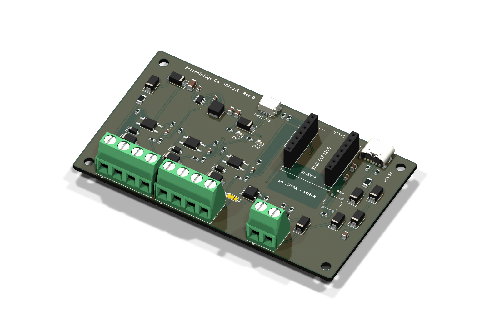
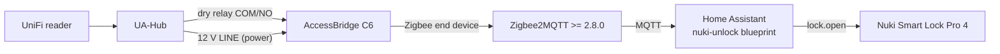

# AccessBridge

**Zigbee dry-contact bridge between a UniFi Access UA-Hub and Home Assistant.**
When the UA-Hub grants access, it closes a potential-free relay contact.
AccessBridge detects the closure and reports it over Zigbee to Zigbee2MQTT.
Home Assistant can then unlatch a Nuki Smart Lock Pro 4. No cloud and no Wi-Fi.

| Part | Name | Version | Licence |
|---|---|---|---|
| Hardware | AccessBridge C6 (Seeed XIAO ESP32C6 carrier) | HW-1.1, PCB Rev B | [CERN-OHL-S-2.0](LICENSE-HARDWARE) |
| Enclosure | 3D-printable case, DIN-rail or wall-screw variant | for HW-1.1 | [CERN-OHL-S-2.0](LICENSE-HARDWARE) |
| Firmware | AccessBridge Zigbee (ESPHome 2026.9.1) | FW-1.0.0 | [MIT](LICENSE) |
| Integrations | Home Assistant blueprints, Zigbee2MQTT notes | - | [MIT](LICENSE) |



> [!WARNING]
> **Not hardware-tested.** Rev B has passed ERC/DRC, the firmware compiles,
> and the Home Assistant logic is covered by automated tests. No board has
> been manufactured or measured yet, and nothing has been tested with a real
> UA-Hub or Nuki. See [compatibility status](#compatibility-status).
>
> **Security:** this device is part of a door access chain. Whoever can short
> the relay wires, or controls your Zigbee/MQTT/Home Assistant, can open the
> door. Read [docs/security.md](docs/security.md) before use. **Never connect
> mains voltage to this board.**

## How it works



* The contact loop is powered by the board itself (optocoupler, about 3.3 mA),
  so no external voltage is needed on the relay contact.
* The firmware reports the contact **state** and a **pulse counter** of new
  closures. Home Assistant only unlatches on a +1 step of the counter that
  passes the freshness, cooldown and enable checks. Restarts, rejoins and
  restored states never unlatch. Details: [docs/security.md](docs/security.md).
* Power from the UA-Hub 12 V **or** a USB-C charger (J6, power only; the whole
  board including the contact inputs runs on USB for bench tests). Firmware is
  flashed through the XIAO's own USB-C, next to J6 on the same edge.
* Optional: doorbell input (230 V bells via a certified coupling relay), a
  door-position (DPS) port that works as an input or as an isolated contact
  output, a 12 V open-drain output, and a Qwiic I2C port.

More detail: [docs/architecture.md](docs/architecture.md).

## Supported hardware

| Component | Status |
|---|---|
| UniFi Access **UA-Hub** (classic), LINE 12 V output + dry Lock/Aux relay | designed for; LINE "always on" must be measured on site |
| UA-Hub Door / Gate Hub / Enterprise Hub | not covered (different I/O) |
| Seeed Studio XIAO ESP32C6 | required (socketed) |
| Zigbee2MQTT >= 2.8.0 | designed for (generated definition, no converter) |
| ZHA | not covered by the docs; the firmware uses standard clusters |
| Nuki Smart Lock Pro 4 via the HA Nuki integration (`lock.open`) | designed for |

## Compatibility status

| Level | HW-1.1 Rev B + FW-1.0.0 |
|---|---|
| Statically checked (ERC, DRC with parity, ESPHome config, HA check_config) | **yes** |
| Enclosure fit-checked against the PCB STEP (CI) | **yes** |
| Firmware compiled (CI) | **yes** |
| Software-tested (HA blueprint behaviour tests, 12/12) | **yes** |
| Electrically tested | no |
| Tested with Zigbee2MQTT | no |
| Tested with a real UA-Hub | no |
| Tested with a Nuki | no |

Test plan and record: [docs/testing.md](docs/testing.md).

## Project status (development workflow)

| # | Step | Status |
|---|---|---|
| 1 | Feasibility and datasheet review | done; open points: UA-Hub LINE always-on, XIAO antenna position, Hammond boss positions, live LCSC stock |
| 2 | Schematic | done (`hardware/kicad/accessbridge.kicad_sch`) |
| 3 | ERC | done: 0 errors, 0 warnings |
| 4 | PCB layout | done: 96 x 56 mm, 2 layers (Rev B = Rev A + USB-C power input) |
| 5 | DRC | done: 0 violations, 0 unconnected, 0 parity issues |
| 6 | Fabrication data and BOM | done: Gerber ZIP, drill, JLCPCB BOM/CPL (reproducible, checked in CI) |
| 7 | Firmware implemented and compiled | done (ESPHome 2026.9.1, CI) |
| 8 | Zigbee2MQTT compatibility test | open: needs hardware |
| 9 | Home Assistant example | done (blueprints, check_config, 12 behaviour tests) |
| 10 | Security tests | documented; software part done; hardware part open |
| 11 | Enclosure and mounting check | 3D-printable case (DIN-rail and wall variants) designed and fit-checked against the PCB STEP in CI; not printed yet. Hammond 1591XXD documented as alternative |
| 12 | Release artifacts | workflow ready; first release after the hardware tests |

## Wiring (classic UA-Hub)

| AccessBridge | UA-Hub |
|---|---|
| J1-1 `+12V` | LINE 12V (+) |
| J1-2 `GND` | LINE 12V (-) |
| J1-3 `RELAY COM` | Lock (or Aux) relay COM, **dry mode** |
| J1-4 `RELAY NO` | Lock (or Aux) relay NO |
| J6 USB-C (optional) | any USB-C charger, 5 V, power only, e.g. for bench tests |

Full instructions, doorbell and DPS options: [hardware/docs/wiring.md](hardware/docs/wiring.md).

## Firmware installation

```sh
pip install esphome==2026.9.1
cd firmware/esphome
esphome run accessbridge.yaml      # build + flash over USB-C
```

Or flash a release binary with `esptool.py`. See [docs/installation.md](docs/installation.md).

## Zigbee2MQTT pairing

1. Permit join in Zigbee2MQTT (>= 2.8.0).
2. Power the AccessBridge. The status LED blinks fast until it has joined.
3. The device appears as `esphome` / `accessbridge` with a generated
   definition, with no converter needed.
4. Permit join off. To re-pair, hold PAIR for 5-15 s.

Details and expected exposes: [integrations/zigbee2mqtt](integrations/zigbee2mqtt/README.md).

## Home Assistant example

Import the blueprint [`nuki-unlock.yaml`](integrations/home-assistant/automations/nuki-unlock.yaml)
and select the `relay_pulses` sensor, the `relay_contact` binary sensor and
your Nuki lock. Every ignored pulse is logged with its reason, and unconfirmed
unlatch commands are logged as errors.
See [integrations/home-assistant](integrations/home-assistant/README.md).

## Manufacturing

| | |
|---|---|
| Gerber + drill ZIP (JLCPCB) | [hardware/manufacturing/accessbridge-c6-HW-1.1-revB-gerbers.zip](hardware/manufacturing/accessbridge-c6-HW-1.1-revB-gerbers.zip) |
| JLCPCB BOM / CPL | [bom](hardware/manufacturing/bom/), [pick-and-place](hardware/manufacturing/pick-and-place/) |
| Schematic PDF | [hardware/docs/schematic.pdf](hardware/docs/schematic.pdf) |
| Dimension drawing | [hardware/enclosure/drawings](hardware/enclosure/drawings/accessbridge-c6-dimensions.pdf) |
| Ordering and assembly | [hardware/docs/assembly.md](hardware/docs/assembly.md) |
| Enclosure (3D print, STL/STEP) | [hardware/enclosure](hardware/enclosure/README.md): DIN-rail or wall-screw base, lid, plunger, cable clamp |
| Cost estimate (2/5/10 units) | [hardware/docs/cost-estimate.md](hardware/docs/cost-estimate.md) |
| Releases | [GitHub releases](https://github.com/imsandli/esp32-access-bridge/releases), [releases/README.md](releases/README.md) |

## Repository layout

```
hardware/      KiCad sources, fabrication data (generated), docs, 3D-printed enclosure (CadQuery)
firmware/      ESPHome configuration (FW-1.0.0); ESP-IDF fallback plan
integrations/  Home Assistant blueprints + tests, Zigbee2MQTT notes
docs/          architecture, security, installation, configuration, testing
scripts/       ERC/DRC validation, Gerber/BOM export (KiCad CLI, Docker fallback)
releases/      release process and version scheme
```

## Contributing and licences

See [CONTRIBUTING.md](CONTRIBUTING.md) and [CHANGELOG.md](CHANGELOG.md).
Software (firmware, scripts, integrations, docs) is MIT. Hardware design files
under `hardware/` are CERN-OHL-S-2.0.
