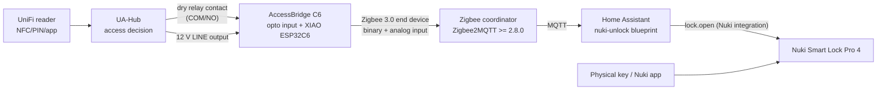

# Architecture

## Purpose

AccessBridge turns the potential-free relay contact of a **UniFi Access UA-Hub
(classic model)** into a Zigbee event for **Zigbee2MQTT**. Home Assistant can
then unlatch a **Nuki Smart Lock Pro 4** after the UA-Hub has granted access.

## Architecture decisions

| # | Decision | Reason |
|---|---|---|
| A1 | **Seeed XIAO ESP32C6** in two 1x7 sockets | The ESP32-C6 has an 802.15.4 radio (Zigbee). The module stays replaceable, and its USB-C port stays accessible for flashing. |
| A2 | **ESPHome 2026.9.1** with the native `zigbee` component | ESPHome supports Zigbee end devices on the ESP32-C6 (binary sensors as Binary Input, sensors as Analog Input). See [firmware/README.md](../firmware/README.md). There is no ESP-IDF implementation for FW-1.0.0; see [firmware/esp-idf](../firmware/esp-idf/README.md). |
| A3 | **No external Zigbee2MQTT converter** | Zigbee2MQTT generates definitions automatically for `genBinaryInput` / `genAnalogInput` clusters (`generateDefinition.ts`). |
| A4 | **Optocoupler inputs** with a loop current supplied by the board (about 3.3 mA from the board's own 12 V rail) | The contact needs no external voltage. The relay contacts get a real wetting current, and the field wiring never reaches a GPIO. A wiring mistake (for example, the UA-Hub relay jumpered to "powered") cannot damage the MCU. |
| A5 | **Pulse counter** (`relay_pulses`) in addition to the contact state | It separates "contact is closed" from "a new authorized closure happened". Home Assistant only acts on a +1 step of the counter. See [security.md](security.md). |
| A6 | **Fixed-output buck AP63205 (12 V to 5 V)** feeding the XIAO 5V pin through a Schottky diode | It needs no potentiometer, protects against short circuits and over-temperature, and uses PFM at light load. The diode follows Seeed's guidance (anode = external supply, cathode = 5V pin) and blocks back-feeding from USB. |
| A7 | **No mains voltage on the PCB** | A 230 V doorbell is connected through a certified coupling relay, installed by an electrician (see [wiring](../hardware/docs/wiring.md)). |
| A9 | **USB-C on the carrier is power-only** (Rev B, J6) | The XIAO ESP32C6 does not route USB D+/D- to its pins, so a carrier USB-C cannot carry firmware data. J6 supplies 5 V to the XIAO and, through `V_LOOP`, to the contact loops, for bench tests and as a fallback. Firmware goes through the XIAO's USB-C on the same edge. |
| A10 | **3D-printed enclosure** (CadQuery, parametric, fit-checked against the PCB STEP in CI) in a DIN-rail and a wall-screw variant | Printable, follows PCB changes, no manual machining. The Hammond 1591XXD remains as an alternative. |
| A8 | **Doorbell and DPS are informational** | Only the UA-Hub relay input can lead to an unlatch. Firmware and blueprints never connect the doorbell to the lock. |

## Interfaces validated before design

| Interface | Source | Result |
|---|---|---|
| UA-Hub LINE output | UniFi tech specs and UA-Hub Quick Start Guide (via search results; `ui.com` was not reachable from the build environment) | 12 V DC, max. 0.33 A. Intended to power accessories such as motion sensors. **Open point:** it is not documented whether LINE is always on. It must be measured before installation ([installation.md](installation.md)). |
| UA-Hub Lock / Aux relays | same | Dry relay outputs rated 30 V DC / 1 A. The Lock relay can also be jumpered to "powered" (12 V). AccessBridge expects **dry** mode, but survives powered mode without damage (A4). |
| XIAO ESP32C6 pins | [Seeed wiki source](https://github.com/Seeed-Studio/wiki-documents) (getting started page, pin table) | D0=GPIO0, D1=GPIO1, D2=GPIO2, D3=GPIO21, D4=GPIO22, D5=GPIO23, D6=GPIO16, D7=GPIO17, D8=GPIO19, D9=GPIO20, D10=GPIO18. RF switch: GPIO3 low enables, GPIO14 selects the antenna (low = ceramic). |
| XIAO 5V input | Seeed wiki ("5V ... can also be used as a voltage input but you must have some sort of diode ... anode to battery, cathode to 5V pin") | Implemented with D3 (SS14). |
| XIAO footprint | Seeed OPL KiCad library `XIAO-ESP32-C6-DIP` | Rows 15.24 mm apart, 2.54 mm pitch, pin 1 = D0. The USB end defines the module orientation. |
| ESPHome Zigbee | `esphome==2026.9.1` source and docs | Supported on ESP32-C6. End device by default. `report: force`, `endpoint`, `on_join`, `zigbee.factory_reset`. No Zigbee OTA. Switches over Zigbee only on nRF52 (planned upstream for ESP32). ESPHome notes the C6 is less reliable than the H2. |
| Zigbee2MQTT | `zigbee-herdsman-converters` source and ESPHome docs | Generated definitions for Binary/Analog Input. ESPHome devices need Zigbee2MQTT >= 2.8.0. |

## Galvanic isolation: assessment

The board is powered from the UA-Hub, so its ground **is** the UA-Hub ground.
An isolated input would therefore only make sense with an isolated supply for
the contact loop as well (an isolated DC/DC converter plus optocoupler). That is
**not needed** here:

* The relay contact is potential-free. The contact loop is fed and returned
  by AccessBridge itself, so no current flows through any other ground path.
* All circuits are SELV/PELV 12 V from the same PoE-powered UA-Hub. There is
  no mains, and no second earth reference.
* The optocouplers still give **functional isolation**: the field wiring
  (COM/NO/A/B terminals) never connects to a GPIO pin. ESD and surges on the
  wires are clamped by the TVS diodes (SMAJ15CA) and limited by series
  resistors on the field side.

Conditions for this shared-ground design to stay safe:

1. Use only the UA-Hub 12 V LINE output (or another SELV supply referenced to
   the same UA-Hub ground) for power.
2. Relay contacts must be potential-free (UA-Hub relay in **dry** mode) or a
   12 V SELV signal from the same UA-Hub.
3. Keep wiring short, inside the same cabinet or building section, and use
   twisted pairs. Do not route it in parallel with mains cables.
4. **Never** connect mains voltage to any terminal. A 230 V doorbell
   **must** go through a certified coupling relay.
5. Do not connect the board ground to a separate earth or to another device's
   supply.

If any of these conditions cannot be met (for example, an input from a
different building or a different supply), a future revision would need
isolated loop supplies. This is listed as a known limitation in
[security.md](security.md).

## Hardware blocks

See [hardware/README.md](../hardware/README.md) and the
[schematic PDF](../hardware/docs/schematic.pdf).

| Block | Parts | Function |
|---|---|---|
| Input protection | F1 PTC 200 mA, D1 SMAJ15A, D2 SS14 | Overcurrent, surge clamp, reverse polarity (a reversed input conducts through D1 and trips F1) |
| 5 V buck | U1 AP63205WU-7, L1 4.7 µH, C1-C5 | 12 V to 5 V, values per the datasheet's typical application |
| XIAO feed | D3 SS14, C6 | Seeed-compliant external 5 V |
| Contact inputs x3 | U3-U5 EL357N, R 2.2k/1k loop, D6-D8 reverse diode, D9-D11 SMAJ15CA, 10k pull-up, 1k/10n RC | Dry-contact detection, active low |
| DPS port | JP1/JP2 solder jumpers, U6 CPC1014N PhotoMOS | Either a third input, or an isolated contact *output* that emulates a door reed toward the UA-Hub DPS input (FW-1.1.0, planned) |
| Open-drain output | Q1 AO3400A, D12 flyback, J4 | 12 V low-side switch, max. 100 mA (Zigbee control planned) |
| USB-C power (Rev B) | J6 USB4125-GF-A, R22/R23 5.1k CC, F2 500 mA PTC, D14 SMAJ5.0A, D13/D15/D16 SS14 | 5 V input, diode-OR into the XIAO 5V pin and the contact-loop rail `V_LOOP` |
| UI | D4 PWR LED, D5 status LED, SW1 PAIR | Power, Zigbee link state, re-pairing |
| Expansion | J3 Qwiic (I2C, 3.3 V), J5 header (not populated) | Future sensors |
