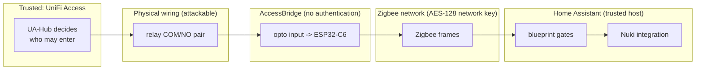

# Security

AccessBridge is part of a **door access chain**. Read this page before you
connect it to a lock.

> **Status:** The security behaviour below is implemented and tested in
> software only: Home Assistant blueprint behaviour tests, and ESPHome
> configuration validation and compilation. It has **not** been tested on
> physical hardware, with a real UA-Hub or with a real Nuki. See
> [testing.md](testing.md).

## Trust boundaries

| Boundary | What is trusted | What is **not** guaranteed |
|---|---|---|
| UA-Hub to relay wire | The UA-Hub only closes the relay after a valid credential. | The wire carries no authentication. **Anyone who can short COM and NO opens the door.** |
| AccessBridge | Firmware counts only new, debounced closures while joined. | The device cannot prove the closure came from the UA-Hub. |
| Zigbee | Frames are encrypted with the network key. Only paired devices can send. | There is no end-to-end authentication from the UA-Hub to Home Assistant. A compromised Zigbee network or coordinator can inject events. |
| Zigbee2MQTT / MQTT | Local broker. | Anyone with write access to the MQTT broker can publish fake states. Secure the broker with credentials and ACLs. |
| Home Assistant | Runs the gates and calls the lock. | Anyone who controls HA controls the lock anyway. |

**Consequence:** the overall security is limited by the **physical security of
the relay wiring** and of the **Zigbee/MQTT/HA infrastructure**. Install
AccessBridge and the wiring **on the secure (inside) side of the door**, in a
closed enclosure, and never route the COM/NO pair through areas reachable from
outside.

## Separating state from events

| Signal | Meaning | Used for unlocking? |
|---|---|---|
| `relay_contact` | Current debounced contact state | **No.** It is re-sent after restarts and rejoins and restored by HA. |
| `relay_pulses` | Number of new closures since boot (RAM, starts at 0) | **Yes**, but only on an exact +1 step that passes all gates |

### Firmware rules (`firmware/esphome/packages/contact-sensor.yaml`)

* Debounce: `delayed_on` / `delayed_off` = `${debounce}` (default 40 ms).
* `trigger_on_initial_state: false`, and a closure only counts if the
  **previous state was a known "open"**. A contact that is closed at power-up
  never counts.
* A closure only counts while the device is **joined** to the Zigbee network
  (`zigbee.is_joined()`). Pulses seen while offline are logged and dropped,
  so they can never be delivered late after a reconnect.
* Minimum interval between counted pulses: `${min_pulse_interval_ms}`
  (default 1500 ms), against relay chatter.
* The counter is not persisted. After a reboot it starts at 0, which Home
  Assistant reads as a reset, not as a pulse.

### Home Assistant gates (`integrations/home-assistant/automations/nuki-unlock.yaml`)

All of these must pass before `lock.open` / `lock.unlock` is called:

1. **Exact +1 step** between two numeric counter values. Ignored silently:
   `unavailable`/`unknown` to a number (HA restart, Zigbee2MQTT restart,
   restored state) and decreases (device reboot). A jump by more than 1
   (missed reports) is **logged as a warning and not acted on**.
2. **Freshness:** the relay contact is closed now or changed within the
   freshness window (default 15 s). This blocks late deliveries.
3. **Cooldown:** no run within the cooldown (default 10 s) of the previous
   run.
4. **Enable switch** (optional `input_boolean`), for example off during
   holidays.
5. **Door gate** (optional): nothing happens while `door_closed` is off.

After the call, the blueprint waits for the lock to report `opening` / `open` /
`unlocking` / `unlocked`. If it does not, it writes an **error** to the
system log ("FAILED or was not confirmed").

## Required behaviour, and where it is implemented

| Requirement | Implementation | Verified by |
|---|---|---|
| No unlock from a Zigbee rejoin | Firmware counts edges only. A rejoin re-sends the unchanged counter value (no state change in HA). | Blueprint test `test_restored_state_is_ignored`; HIL test T-RJ-1 (open) |
| No unlock from a reboot | `trigger_on_initial_state: false`, previous-state check, counter resets to 0 (a decrease is ignored) | `test_device_reboot_is_ignored_silently`; HIL test T-RB-1/2 (open) |
| No unlock from a restored state | Gate 1 needs two numeric values | `test_restored_state_is_ignored` |
| Repeated triggers suppressed | Firmware minimum interval, HA cooldown, `mode: single` | `test_cooldown_suppresses_repeats` |
| Contact state alone never unlocks | Trigger is the counter only | `test_contact_state_alone_never_unlatches` |
| Power or communication failure | Fails closed: no events, Nuki stays locked. The key and the Nuki app still work. | HIL tests T-PW-*, T-ZB-* (open) |
| Failed unlatch logged | `system_log.write` level error | `test_unconfirmed_unlatch_is_logged_as_error` |

## Failure modes

| Failure | Effect | Safe? |
|---|---|---|
| AccessBridge without power | No events. The door does not open from the UA-Hub. Use the key or the Nuki app. | Fails closed |
| Zigbee link lost | Pulses are not counted (logged). After reconnect nothing is replayed. | Fails closed |
| HA or Zigbee2MQTT down | No action. After restart, restored states are ignored. | Fails closed |
| Nuki offline | The unlatch call fails and an error is logged. | Fails closed |
| Relay contact welded closed | One pulse at most, then no new edges. | Fails closed after one event |
| Wire pair shorted by an attacker | **Door opens** (after the gates). | **Not protected.** Physical security of the wiring is required. |
| Zigbee/MQTT/HA compromised | An attacker can open the lock. | **Not protected.** Secure the infrastructure. |
| DPS output mode (FW-1.1.0, planned) | HA could fake "door closed" toward the UA-Hub and suppress UniFi "door forced/held open" alarms. | Accept knowingly. On power or Zigbee loss the SSR opens, so the hub sees "open" (fails loudly). |

## The physical key must keep working

The Nuki Smart Lock Pro 4 is mounted on the inside, and the cylinder must
allow a key from the outside even when a key is inserted on the inside
(cylinder with an emergency/hazard function, as required by Nuki). AccessBridge
never prevents manual operation. Plan for **all** electronic paths failing.

## Hardening checklist

- [ ] Wiring and AccessBridge on the inside, in a screwed enclosure
- [ ] UA-Hub relay in **dry** mode, used only for this purpose
- [ ] Zigbee network key not the default; permit-join off after pairing
- [ ] MQTT broker with authentication; Zigbee2MQTT frontend password-protected
- [ ] Home Assistant: blueprint with cooldown, freshness and enable switch configured
- [ ] Test the failure scenarios in [testing.md](testing.md) after every change
