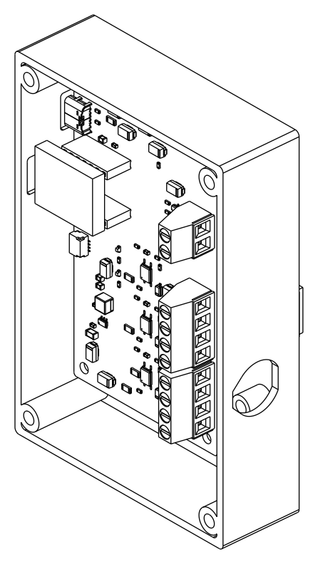

# Enclosure

Two options:
* **A) a 3D-printed case** (recommended). It is designed for AccessBridge C6
  HW-1.1 / Rev B and checked against the PCB's STEP model.
* **B) a commercial Hammond 1591XXD box**, which needs manual machining.

## A) 3D-printed case



| | DIN-rail variant | Wall-screw variant |
|---|---|---|
| Base part | `models/accessbridge-enclosure-base-din.stl` | `models/accessbridge-enclosure-base-wall.stl` |
| Mounting | integrated TS35 clip (fixed hook + spring latch, screwdriver release slot). Sits next to the UA-Hub on the same rail | 2 flanges with 4.5 x 8 mm slots (4 mm wood screws or M4). The box can be mounted with the lid closed |
| Outside (without clip/flanges) | 118.8 x 81.4 x 29.7 mm | 118.8 x 81.4 x 29.7 mm |
| Overall | 118.8 x 81.4 x 35.6 mm (clip adds ~6 mm on the back) | 140.8 x 81.4 x 29.7 mm |
| Preview | [underside](drawings/enclosure-base-din-underside.png) | [top](drawings/enclosure-base-wall.png), [underside](drawings/enclosure-base-wall-underside.png) |

Shared parts:

| Part | File | Notes |
|---|---|---|
| Lid | `models/accessbridge-enclosure-lid.stl` | 4 counterbored M3 holes, 2 mm light holes above the PWR/STAT LEDs, guide for the PAIR plunger, engraved label |
| PAIR plunger | `models/accessbridge-enclosure-plunger.stl` | Rod Ø4 with flange. Insert it from inside before closing the lid |
| Cable clamp | `models/accessbridge-enclosure-clamp.stl` | Strain-relief bar on two posts behind the cable gland |

STEP files of every part are next to the STLs. Previews:
[base](drawings/enclosure-base-top.png), [USB side](drawings/enclosure-base-usb-side.png),
[lid](drawings/enclosure-lid.png).

### Features

* **USB-C:** two openings in the top wall, one for the XIAO's USB-C (firmware +
  power) and one for J6 (USB-C power). Each has an outside recess, so the wall
  is only 1.2 mm thick there and standard plug overmolds mate fully.
* **Cable entry:** M16 x 1.5 cable gland in the terminal wall (flat-topped
  teardrop hole, printable without supports), plus a clamp bar on two posts
  (M3 inserts) as strain relief. About 20 mm of wiring room in front of the
  terminals.
* **PCB mounting:** 4 standoffs (5 mm, M3 heat-set inserts) on the PCB hole
  pattern (88 x 48 mm).
* **Lid:** 4 corner bosses with M3 heat-set inserts. The locating lip has a
  cut-out above the gland nut.
* **Antenna:** no inserts within 10 mm of the XIAO antenna keep-out (checked).
  Use a non-metallic filament without carbon fibre.

### Fit check (automated)

`check_fit.py` loads the KiCad STEP export of the assembled PCB
(`models/pcb/accessbridge-c6.step`) and an envelope for the XIAO module, then
fails unless:

1. no part (either base, the lid, plunger or clamp) intersects the PCB or any
   component;
2. the lid is at least 1.5 mm above the tallest part (actual value: 4.5 mm);
3. both USB-C openings lie inside their cut-outs with at least 0.5 mm margin,
   with at least 1 mm of wall above them, and the wall at the recesses is
   1.5 mm or less;
4. the M16 lock nut fits between the floor and the lid seat;
5. no metal insert is within 10 mm of the antenna keep-out;
6. all parts are valid solids.

`scripts/tools/check_enclosure_models.py` verifies that the committed STLs are
watertight and match the CadQuery source. Both run in CI (`hardware`
workflow, `enclosure` job).

**Not verified:** the XIAO module has no 3D model. Its height above the sockets
(2.5 mm header spacer + 1.0 mm PCB + 3.3 mm parts) is a conservative estimate.
The XIAO USB-C cut-out is 8 mm tall to absorb the tolerance, but **measure the
assembled board** before printing. Change `XIAO_SPACER` / `XIAO_PCB` in the
model if your headers differ. The DIN clip and the plunger also need a test
print (tests T-ME-4 to T-ME-6 in [docs/testing.md](../../docs/testing.md)).

### Printing

| Setting | Value |
|---|---|
| Material | **PETG or ASA** (heat in distribution cabinets: not PLA). No carbon/metal-filled filaments (Zigbee antenna) |
| Layer height | 0.2 mm |
| Walls | 4 perimeters, 25 % infill, 5 top/bottom layers |
| Orientation | base: floor down (DIN clip variant: on the clip face with a brim, or floor down with tree supports under the clip only); lid: outside face down; plunger: flange down; clamp: flat |
| Supports | none, except under the DIN clip lip if printed floor-down |

### Hardware to buy

| Qty | Part |
|---|---|
| 10 | M3 brass heat-set inserts, Ø4.0 x 5.7 mm (4 lid, 4 PCB, 2 clamp) |
| 4 | M3 x 8 cylinder-head screws (PCB) |
| 4 | M3 x 10 cylinder-head screws (lid) |
| 2 | M3 x 12 screws (clamp bar) |
| 1 | M16 x 1.5 nylon cable gland, IP54+, clamping range for your cable (e.g. 4-8 mm), with lock nut |
| (wall variant) 2 | 4 mm wood screws + plugs, or M4 |

Assembly: press the inserts in with a soldering iron (about 220-240 °C for
PETG). Mount the PCB with 4 x M3 x 8. Insert the plunger from inside, then
close the lid with 4 x M3 x 10.

### Source and regeneration

The model is parametric: `models/accessbridge_enclosure.py` (CadQuery). It
reads the board outline, mounting holes, USB-C, LED, button and terminal
positions from `hardware/tools/design.py`, so it follows PCB changes.

```sh
pip install -r hardware/enclosure/requirements.txt
scripts/export-enclosure.sh        # STEP + STL + previews + fit check
```

The PCB STEP is produced by `scripts/export-gerbers.sh` (it needs the KiCad
3D models, Docker image `kicad/kicad:9.0.9-full`).

## B) Alternative: Hammond 1591XXD (ABS, screwed lid)

| | Value | Source |
|---|---|---|
| Model | Hammond 1591XXDBK / 1591XXDGY, flanged 1591XXDFLBK | Hammond 1591XX series |
| Outside | 152 x 82 x 51 mm (series table) | Hammond |
| Max. PCB size | 145 x 75 mm (board: 96 x 56 mm) | Hammond part page 1591XXDBK |

The Hammond drawings were not reachable from the design environment. The
internal bosses will not match the 88 x 48 mm hole pattern, so mount the PCB
on M3 x 6 nylon standoffs. Cut-outs needed: 2x USB-C (12 x 7 mm, positions
from the [dimension drawing](drawings/accessbridge-c6-dimensions.pdf)), and
an M16 gland on the terminal side.
